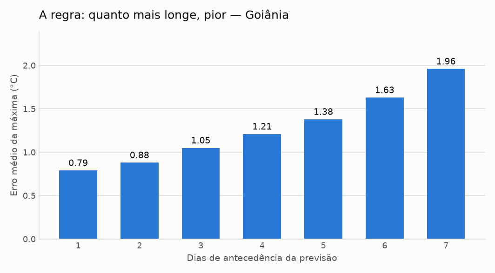
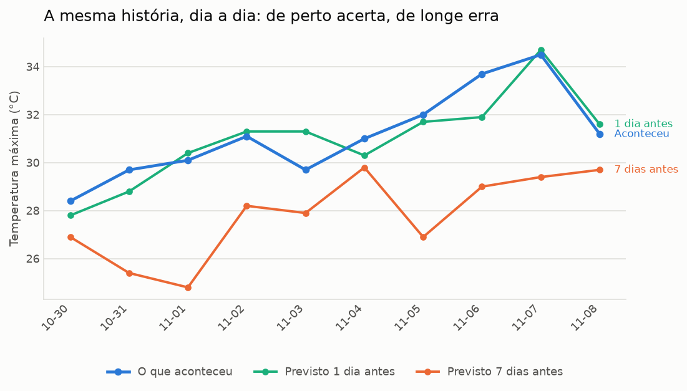

# Boletim semanal de acerto da previsão — Goiânia

**2026-11-09** · semana de 2026-11-02 a 2026-11-08 · 377 previsões no histórico

> Previsões conferidas: 371 recuperadas do arquivo de rodadas antigas do Open-Meteo e 6 coletadas pelo próprio robô, dia a dia. São previsões reais, emitidas antes da data que descrevem — nada aqui é simulado.

## Análise

Na semana de 2026-11-02 a 2026-11-08, o erro médio da temperatura máxima foi de 1.81 °C em 49 previsões conferidas — pior que o acumulado, que está em 1.27 °C. No boletim anterior, de 2026-09-21, a semana havia fechado em 1.22 °C.

O viés de -1.3 °C indica que a previsão tende a ficar abaixo do que se observa. O acerto entre "vai chover" e "não vai" foi de 85.7%. O maior desacerto do histórico foi em 2026-11-07: previa 27.9 °C e foram 34.5 °C.

Na prática: com 1 dia de antecedência, conte com cerca de 0.79 °C de margem; com 7 dias, a margem sobe para perto de 1.96 °C. Para decisões que não podem errar, prefira confirmar na véspera.

texto automático (sem GEMINI_API_KEY). Os números são calculados em Python; a IA só redige, e o texto passa por uma auditoria que recusa qualquer número que não saia do cálculo.

## A semana, comparada

| Medida | Esta semana | Acumulado |
|---|---|---|
| Previsões conferidas | 49 | 377 |
| Erro médio da máxima | 1.81 °C | 1.27 °C |
| Erro médio da mínima | 0.65 °C | 1.26 °C |
| Viés da máxima | -1.3 °C | +0.19 °C |
| Acerto chove / não chove | 85.7% | 94.4% |

## Quanto a previsão erra, por antecedência

Sobre todo o histórico. É a regra central do boletim: a previsão de véspera é boa, a de uma semana é um palpite informado.

| Antecedência | Previsões | Erro médio máx. | Erro médio mín. | Viés máx. |
|---|---|---|---|---|
| 1 dia | 54 | 0.79 °C | 0.66 °C | +0.4 °C |
| 2 dias | 54 | 0.88 °C | 0.83 °C | +0.51 °C |
| 3 dias | 54 | 1.05 °C | 0.86 °C | +0.42 °C |
| 4 dias | 54 | 1.21 °C | 1.02 °C | +0.3 °C |
| 5 dias | 54 | 1.38 °C | 1.21 °C | +0.43 °C |
| 6 dias | 54 | 1.63 °C | 2.1 °C | -0.16 °C |
| 7 dias | 53 | 1.96 °C | 2.12 °C | -0.57 °C |

E a mesma regra vista dia a dia: a previsão feita 1 dia antes acompanha o que aconteceu; a de 7 dias se descola.

## Chuva: acertou o sim ou não?

Na semana. Considera-se que choveu a partir de 1.0 mm no dia.

| Situação | Dias |
|---|---|
| Previu chuva e choveu | 40 |
| Previu chuva e não choveu | 5 |
| Não previu e choveu | 2 |
| Previu seco e ficou seco | 2 |

## Maior desacerto do histórico

Em **2026-11-07**, com 6 dias de antecedência: previsto 27.9 °C, observado 34.5 °C (-6.6 °C).

---

Dados: Open-Meteo. O “observado” é a melhor estimativa da API para datas passadas (reanálise), não a leitura de uma estação específica. Gerado automaticamente por [GeocursoAtividade3](https://github.com/VictorGit10/GeocursoAtividade3).
